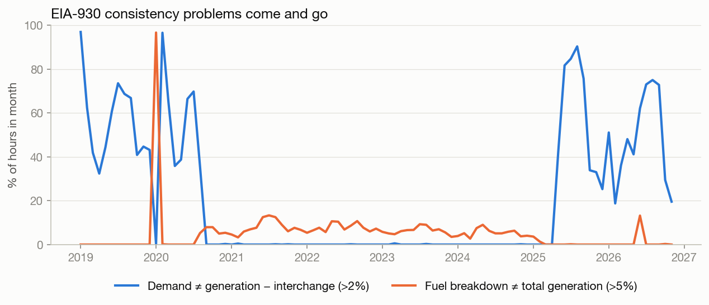
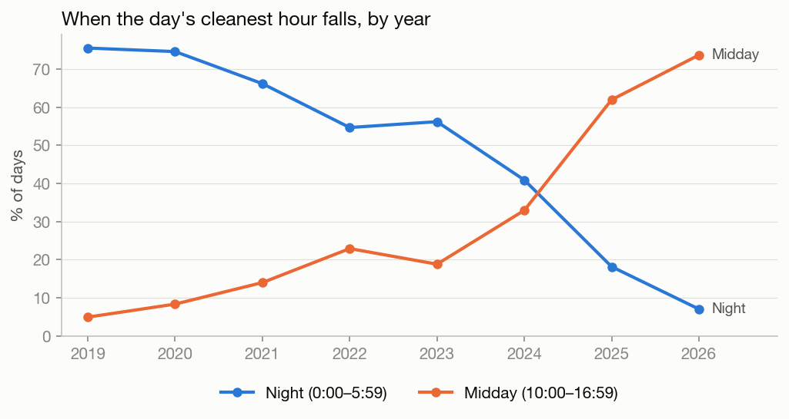

# Milestone 2: Data Quality and Exploratory Analysis

Predicting Low-Carbon Hours for Data-Center Computing · Team 100: Allen Garcia, Amy Chen, Clara Cheng, Luke Tan, Sunny Li

Nov 11, 2026 · Drafted by Luke Tan

> Markdown copy of the team's working notes ([live doc](https://claude.ai/artifact/SewUcGzcZSqWesZmuR2W2J)). The two charts in the live doc are replaced here by the matching PNGs in `figures/`.

## Summary

We have a cleaned hourly dataset for PJM covering 1 Jan 2019 to 11 Nov 2026: 68,928 hours, with carbon intensity calculated for 99.1% of them.

- Quality control found five kinds of problems in EIA-930. Each one is now flagged or corrected, and none blocks the project.
- The proposal's scope stays the same, but its method needs tightening (full list in section 8). The main changes:
  1. Define "run immediately" fairly.
  2. Add scheduling baselines and a scheduling metric.
  3. Use only lagged weather.
  4. State that we measure average emissions, not marginal ones.
- Still missing: an outside check of our intensity numbers, and a defined simulated workload.

## Data acquired

All sources are public and need no API key. One script (`build_dataset.py`) rebuilds the whole table from scratch.

| Source | What we use | Coverage | Notes |
| --- | --- | --- | --- |
| [EIA-930 six-month files](https://www.eia.gov/electricity/gridmonitor/about) | Demand, day-ahead demand forecast, net generation, generation by fuel, hourly flows with each of PJM's 7 neighbors | Jan 2019 – Nov 2026 | Fuel-level data starts Jul 2018. We use EIA's cleaned "Adjusted" values where present |
| [EIA CO₂ coefficients](https://www.eia.gov/environment/emissions/co2_vol_mass.php) | kg CO₂ per MMBtu of coal, gas, oil | One value per fuel | Converted to electricity using heat rates (section 3) |
| [EIA Electric Power Annual, Table 8.1](https://www.eia.gov/electricity/annual/html/epa_08_01.html) | Average heat rate by fuel (Btu/kWh) | 2015–2025, by year | 2026 reuses 2025 |
| [NOAA GHCNh](https://www.ncei.noaa.gov/products/global-historical-climatology-network-hourly) | Hourly temperature, dew point, wind | 2019–2026 | Averaged over 6 airports in PJM load centers: PHL, ORD, IAD, BWI, PIT, CMH |

The output, `data/pjm_hourly.csv`, has one row per hour and 51 columns:

- **Calendar:** UTC and Eastern time.
- **Grid:** demand and EIA's demand forecast, generation by fuel, per-neighbor flows.
- **Emissions:** hourly CO₂ (tonnes), and production-based and import-adjusted intensity.
- **Weather** and **quality flags.**

The repository README documents every column.

## Response to proposal feedback

### Units

EIA's coefficients are per unit of fuel energy (kg CO₂/MMBtu), but EIA-930 reports electricity (MW). We multiply each coefficient by that year's average heat rate:

```
kg CO₂/MWh = kg CO₂/MMBtu × heat rate (Btu/kWh) ÷ 1000
```

Unit check: kg per 10⁶ Btu × Btu per kWh = kg per 10⁶ kWh = kg per 1,000 MWh.

| Fuel | kg CO₂/MMBtu | 2025 heat rate (Btu/kWh) | kg CO₂/MWh (2025) |
| --- | --- | --- | --- |
| Coal (all types) | 95.99 | 10,647 | 1,022 |
| Petroleum (distillate) | 74.14 | 10,969 | 813 |
| Natural gas | 52.91 | 7,781 | 412 |
| Nuclear, hydro, wind, solar, storage | 0 | – | 0 |

Hourly intensity is Σ(generation by fuel × factor) ÷ Σ(generation by fuel).

- Negative values (pumped-storage pumping, battery charging) count as zero, because they are consumption, not generation.
- "Other" fuels (mostly biomass, landfill gas and waste) are set to 0. The sensitivity check in section 4 tests that choice.

### Interchange

We compute two targets:

- **Production-based (primary):** emissions from power generated inside PJM, divided by that generation. Imports and exports are ignored.
- **Consumption-based (sensitivity):** power PJM keeps (generation minus exports) is counted at PJM's intensity. Imports from each neighbor are counted at that neighbor's own production-based intensity, computed the same way from EIA-930.

The two correlate at 0.997, differ by +0.2 kg/MWh on average (5th–95th percentile: −3.8 to +6.3), and pick the same cleanest hour on 84% of days. Imports are only 2–4% of PJM demand, so even dirty neighbors such as LG&E-KU (≈905 kg/MWh) barely move the result. The final scheduling results will be reported under both definitions.

## Quality assurance and quality control

We ran 14 checks. Four found problems that would have biased the target if left alone. All are now fixed or flagged in the data, with a `qa_*` column per check.

| # | Check | What it tests | Result (68,928 hours) |
| --- | --- | --- | --- |
| 1 | Complete hourly index | Missing or duplicate UTC hours; DST days | 0 missing, 0 duplicates; 8 days of 23 h and 8 of 25 h, handled by using UTC |
| 2 | Column schema across files | EIA renaming or splitting categories | **Found:** from Jul 2024, EIA splits hydro, solar and wind and adds storage. Our first build dropped them, so intensity was too high. Fixed by summing the subcategories |
| 3 | Fuel coverage | Fuel breakdown ≥ 80% of reported net generation | **Found:** 610 hours below 80%, 564 of them in Jan 2020. Intensity left blank |
| 4 | Fuel sum vs. total | Fuel breakdown within 5% of net generation | 3,497 hours flagged. A ±3% daily-cycle gap is normal for PJM |
| 5 | Demand balance | Demand = net generation − total interchange, within 2% | **Found:** 15,108 hours flagged, concentrated in 2019–20 and from May 2025 (chart below) |
| 6 | Interchange consistency | Reported total interchange vs. sum of per-neighbor flows | 55% of hours differ by >2% of demand. EIA's own "Sum(Valid DIBAs)" column shows the same gap. Informational only |
| 7 | Interchange direction | Sign of net flows by year | **Found:** 2019 shows PJM as a net importer (≈8% of demand); every later year is a net exporter. Treated as a reporting problem |
| 8 | Range: demand | 40–175 GW (PJM's record peak is about 165 GW) | 4 hours above 175 GW |
| 9 | Range: generation | No negative fuel values after clipping storage | 0 violations |
| 10 | Outliers in intensity | Robust z-score > 5 within a 1-week window; hour-to-hour jumps; flat runs | 0 z-score outliers; 79 jumps > 60 kg/MWh (99th percentile jump is 34); 2 flat runs of ≥ 5 hours |
| 11 | EIA imputation | Hours where EIA filled values | 233 hours, kept and flagged |
| 12 | Weather completeness and QC | NOAA quality codes, physical ranges, stations reporting | 135 hours missing; 0.2% of hours have fewer than 6 stations. The old ISD source stops mid-2025, so we switched all years to GHCNh |
| 13 | Plausibility of totals | Annual CO₂ and generation | 270–319 Mt CO₂/yr on 787–874 TWh/yr; mean intensity 328–383 kg/MWh by year |
| 14 | Emission-factor sensitivity | Change assumptions, re-score | "Other" fuels at 400 kg/MWh instead of 0: +5.9 kg/MWh, correlation 0.998, same cleanest hour on 93% of days. Bituminous instead of all-coal factor: −5.3 kg/MWh |



The demand-balance failures affect the demand columns only. Intensity uses just the fuel mix, so the target is unaffected.

The last row matters most for the research question. Plausible changes to the emission factors shift the *level* of intensity by about 2%, but they rarely change which hour is cleanest.

## How each issue is handled

The target is protected first: any hour whose intensity can't be trusted is left blank, not filled in. Problems that touch only features are flagged and handled at modeling time.

| Issue | Decision | Effect on modeling |
| --- | --- | --- |
| EIA category split (Jul 2024) | Sum subcategories back to hydro, solar, wind; storage is its own fuel at 0 kg/MWh | Consistent fuel columns across all years |
| Partial fuel reports (610 hours, mostly Jan 2020) | Intensity left blank | Drop Jan 2020 from training and evaluation; drop the other 46 scattered hours |
| Demand balance failures (2019–20, May 2025 on) | Keep reported demand, flag the hour | Prefer EIA's day-ahead demand forecast as the demand feature; test whether excluding flagged hours changes results |
| 2019 interchange looks reversed | Keep, but don't trust 2019 flows | Leave 2019 out of the consumption-based sensitivity check |
| 4 demand values above 175 GW | Treat as missing | Clip before building demand features |
| Interchange total vs. per-neighbor sum disagree | Use per-neighbor flows for the import adjustment | None for the primary target |
| Observed weather is not available a day ahead | Keep observed weather in the table | Use only weather lagged by ≥ 24 hours; report same-day weather only as an "oracle" upper bound |
| EIA-imputed hours (233) | Keep and flag | Check that results hold without them |

## Key exploratory findings

The grid has changed under us: as solar grew, the day's cleanest hour moved from night to midday. Patterns from early years don't carry over.



A fixed hour learned from 2019–23 (2:00) captures almost none of the possible saving in 2024+. Simple persistence captures 60%, so it is the baseline a model must beat. (1-hour job, test period 2024+; savings are relative to a random start hour.)

| Schedule | Mean kg CO₂/MWh | Saving | Share of oracle saving |
| --- | --- | --- | --- |
| Random start hour | 336.6 | 0% | 0% |
| Fixed hour learned on 2019–23 (2:00) | 335.4 | 0.4% | 5% |
| Always 9:00 | 326.3 | 3.1% | 43% |
| Yesterday's cleanest hour | 322.2 | 4.3% | 60% |
| Oracle (perfect foresight) | 312.8 | 7.1% | 100% |

Other findings:

- **Headroom:** the median day's spread between dirtiest and cleanest hour is 13% of its mean (90th percentile 22%). It is largest in spring and early summer.
- **Predictability:** intensity is strongly correlated with itself 24 hours earlier (0.89). Same-hour-yesterday has MAE 16.5 kg/MWh (4.9% of the mean). Month-by-hour averages do much worse (MAE 35.9).
- **Drivers:** within a day, intensity rises with coal output (r = +0.79), gas (+0.61) and demand (+0.51), and falls with solar (−0.36) and wind (−0.32). The 18:00–22:00 evening peak is the dirtiest time in every season.
- **Level drift:** mean intensity fell from 383 kg/MWh (2019) to 328 (2024), then rose to 343 (2025) as coal output recovered.

## What is still missing

The biggest gap is that our intensity numbers haven't been checked against an independent source. Our checks show the data are internally consistent, not that the absolute level is right.

1. **No outside check of our intensity numbers.** Compare our annual and hourly intensity with an independent source, such as:
   - EPA's hourly stack measurements for PJM power plants (CAMPD),
   - EPA eGRID's annual rates for the RFC subregions,
   - PJM's published emissions reports.

   Target: annual means within about 10%, hourly correlation above 0.9.
2. **Average vs. marginal emissions.** We measure the average intensity of all generation. Shifting a job changes which plant ramps up at the margin, usually gas or coal, and that plant's intensity can be far from the average. This is the main conceptual limitation and must be stated.
3. **No day-ahead weather forecasts.** NOAA's archive is observations only, so the weather we have is not what a scheduler would know a day ahead. Historical forecast archives exist but aren't in the pipeline.
4. **Data-release timing.** We assume all of today's EIA-930 data is available at midnight. In practice it is posted with a lag, which makes the persistence baselines slightly optimistic.
5. **Simulated workload not yet defined.** We still need to fix the job lengths, the daily deadline and whether a job can be split. The baseline numbers above use 1-hour and 4-hour jobs that run within one calendar day.
6. **Plant-level differences.** Heat rates are national fleet averages for each fuel. PJM's coal and gas plants may be more or less efficient than average, which would shift the level but not the hourly pattern.
7. **Location inside PJM.** Intensity covers all of PJM. Data centers cluster in Northern Virginia, but EIA-930 doesn't break out generation by zone.

## Recommended adjustments to the proposal

The research question stays as it is. The changes tighten the method so the result is fair and the TA's two concerns are answered in the proposal itself.

| Proposal currently says | Change to | Why |
| --- | --- | --- |
| Compare the schedule with "running the workload immediately" | Compare with a **random start hour**, and also report always-9:00 | "Immediately" depends on when the job is submitted. In 2024+, 9:00 is already a clean hour, so it understates savings |
| Baselines: persistence and linear regression (for the forecast) | Also add scheduling baselines: **yesterday's cleanest hour** and a **fixed hour** | Yesterday's cleanest hour already gets 60% of the oracle saving. A model is only useful if it beats that |
| Metrics: MAE and RMSE | Keep them, and add **scheduling regret**: intensity of the chosen hour minus the true cleanest hour, plus the share of oracle saving captured | The scheduler only needs to rank hours correctly. A model can have lower MAE and still pick worse hours |
| Weather "if it improves the model" | Use only weather lagged by ≥ 24 hours. Same-day weather is reported only as an "oracle" upper bound | Observed weather for tomorrow isn't known today. Using it would leak future information |
| Time-based train/validation/test split | Train 2019–2022, validate 2023, test 2024 onward. Drop Jan 2020. Consider weighting recent years | The cleanest hour moved from night to midday, so old years are less representative |
| Carbon intensity from emission factors (concern noted) | State the unit conversion and the production-based definition. Report import-adjusted intensity as a sensitivity check | Directly answers both pieces of TA feedback |
| Limitations | Add: average, not marginal, emissions; direct stack emissions only; PJM-wide, not by zone | Readers will ask whether shifting load changes these averages |
| Written in first person singular ("I will") | Use "we" | Five-person team |

None of these change the scope or the data sources. All can be done with the dataset we already have.

## Next steps

In rough order:

- [ ] Cross-check annual and hourly intensity against EPA CAMPD or eGRID
- [ ] Define the simulated workload: job lengths, deadline, whether jobs can be split
- [ ] Build the day-ahead feature set with only data available by midnight: lagged intensity and generation mix, EIA demand forecast, calendar, lagged weather
- [ ] Fit persistence, linear regression, random forest and gradient boosting; score MAE, RMSE and scheduling regret
- [ ] Run the scheduling simulation on the test period under both intensity definitions
- [ ] Update the proposal with the changes in section 8

## References and AI use

- U.S. Energy Information Administration, [EIA-930 Hourly Electric Grid Monitor](https://www.eia.gov/electricity/gridmonitor/about) (six-month files, accessed 11 Nov 2026).
- U.S. Energy Information Administration, [Carbon Dioxide Emissions Coefficients](https://www.eia.gov/environment/emissions/co2_vol_mass.php).
- U.S. Energy Information Administration, [Electric Power Annual, Table 8.1: Average Operating Heat Rate for Selected Energy Sources](https://www.eia.gov/electricity/annual/html/epa_08_01.html).
- NOAA National Centers for Environmental Information, [Global Historical Climatology Network hourly (GHCNh)](https://www.ncei.noaa.gov/products/global-historical-climatology-network-hourly).

**AI use:** Claude (Anthropic) wrote the data pipeline, ran the quality checks and EDA, and drafted this milestone. The team reviewed the code, outputs and text. *[Team: edit this to match how you actually used it.]*
